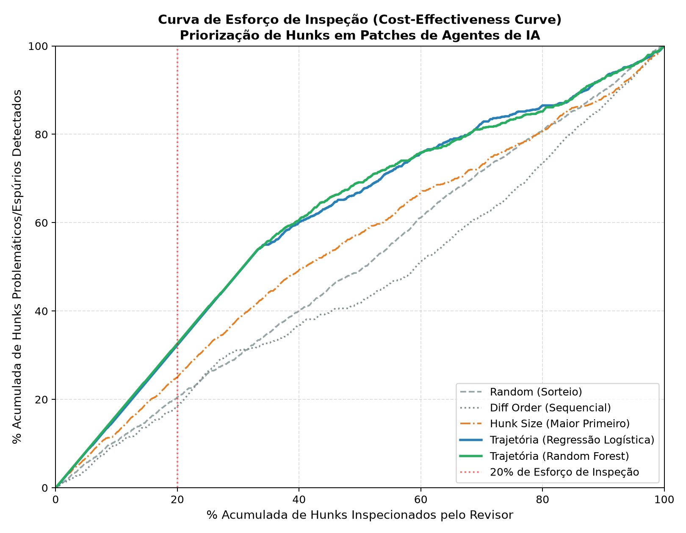

# Onde Revisar Primeiro — Priorização de Hunks em Patches de Agentes

Agentes de código (SWE-agent, OpenHands, Claude Code, Codex) geram patches mais rápido do que uma pessoa consegue revisá-los. Esta pesquisa investiga se **sinais da trajetória de execução do agente** (o que ele leu, testou e errou antes de editar) indicam **quais hunks de um patch têm mais chance de estar errados ou fora de escopo**, melhor do que regras simples como sortear ou olhar primeiro os hunks maiores.

O objetivo prático é dar ao revisor uma ordem de leitura do diff: *"olhe estes trechos primeiro"*.

**Autor:** Giorgio Nicolas de A. Bertino (CDIA — UFPB)
**Status:** estudo exploratório em andamento, sem publicação científica revisada por pares.

**English summary:** An exploratory study of execution-trace signals for prioritizing review of code changes produced by AI agents. The repository contains an extraction pipeline, preliminary model evaluation and inspection prototypes. Current metrics predict a proxy based on overlap with a human reference patch, not independently verified bugs; manual labeling and validation are ongoing.

## Como interpretar esta pesquisa

Os números abaixo são preliminares. **Diferença em relação ao patch humano não demonstra erro:** soluções corretas podem alterar outros trechos, e uma alteração na mesma região pode estar errada. O alvo automático `is_spurious` deve ser interpretado como ausência de alinhamento segundo a heurística implementada, não como confirmação de bug ou alucinação.

A definição de erro está sendo revista com leitura do código e evidências de testes. Consulte o [estado e as limitações da pesquisa](docs/estado-da-pesquisa.md) e a [definição de hunk errado](docs/definicao-hunk-errado.md) antes de usar as conclusões, os gráficos ou os protótipos. A rotulagem manual em andamento ainda não foi incorporada aos modelos da tabela.

## Método, em resumo

- **Dados:** trajetórias públicas do SWE-agent ([fonte](https://huggingface.co/datasets/nebius/SWE-agent-trajectories)). Referências humanas: [SWE-rebench](https://huggingface.co/datasets/nebius/SWE-rebench) e [SWE-bench-extra](https://huggingface.co/datasets/nebius/SWE-bench-extra).
- **Rótulo automático (proxy):** alinhamento do hunk com regiões do *Gold Patch* humano, usando tolerância de 15 linhas. Os nomes históricos `is_pertinent` e `is_spurious` não equivalem a código correto e incorreto.
- **Sinais da trajetória:** leitura antes da edição (`read_before_write`), verificação depois da edição, erro de ferramenta logo antes da edição, posição da edição na trajetória, tamanho do hunk, entre outros.
- **Avaliação:** validação cruzada 5-fold agrupada por instância (`GroupKFold`), com curva de esforço de inspeção, AUCEC, ROC-AUC e Recall@K. O esforço atual conta hunks, não tempo humano ou linhas; o ranking é agregado, sem demonstração de ganho dentro de cada patch.

## Resultados exploratórios sobre o proxy

1.536 hunks extraídos de 1.000 trajetórias (`resultados/metricas_avaliacao_modelos.csv`):

Essas métricas são as registradas no experimento inicial. Não representam taxa de detecção de erros confirmados e não foram recalculadas com os rótulos manuais.

| Estratégia                      | AUCEC | ROC-AUC | Recall@20% | Recall@30% |
| :------------------------------ | ----: | ------: | ---------: | ---------: |
| Random (sorteio)                | 0,505 |   0,512 |      20,5% |      29,7% |
| Diff Order (ordem do diff)      | 0,460 |   0,365 |      18,5% |      31,1% |
| Hunk Size (maior primeiro)      | 0,542 |   0,607 |      25,0% |      38,2% |
| Trajetória (Regressão Logística)| 0,610 |   0,783 |      32,3% |      48,5% |
| Trajetória (Random Forest)      | 0,613 |   0,790 |      32,6% |      48,6% |



## Estrutura do repositório

```
├── docs/          Proposta de pesquisa e guia de início (PDF)
├── scripts/       Código de cada fase do pipeline
├── dados/         Datasets tabulares gerados pelos scripts
├── resultados/    Métricas, figuras e protótipos HTML do inspetor
├── paineis/       Painel de resultados e portal de estudo (HTML)
├── planejamento.md       Planejamento detalhado da pesquisa
└── diario-de-pesquisa.md Diário com decisões e números de cada sessão
```

## Como reproduzir

Requer Python 3.12.

```bash
python -m venv .venv
.venv\Scripts\activate            # Windows  (Linux/macOS: source .venv/bin/activate)
pip install -r requirements.txt

python scripts/mini_projeto_01.py           # Fase 1: exploração de 300 trajetórias
python scripts/extract_hunk_features.py 1000 # Fase 2: extrai hunks e sinais -> dados/
python scripts/model_and_evaluate.py        # Fase 3: modelos, métricas e curva -> resultados/
python scripts/diff_risk_inspector.py       # Fase 4: protótipo do inspetor -> resultados/prototipos/
python scripts/build_learning_portal.py     # gera paineis/aprender_pesquisa.html
```

As fases 1, 2 e 4 baixam dados do Hugging Face via streaming, então precisam de internet.

Os PDFs, painéis e protótipos iniciais preservam a terminologia da fase exploratória. Para a interpretação atual, prevalecem este README e o documento de estado da pesquisa. As dependências e os scripts são os registrados no projeto; a reprodução completa não foi reexecutada durante a preparação desta publicação.
